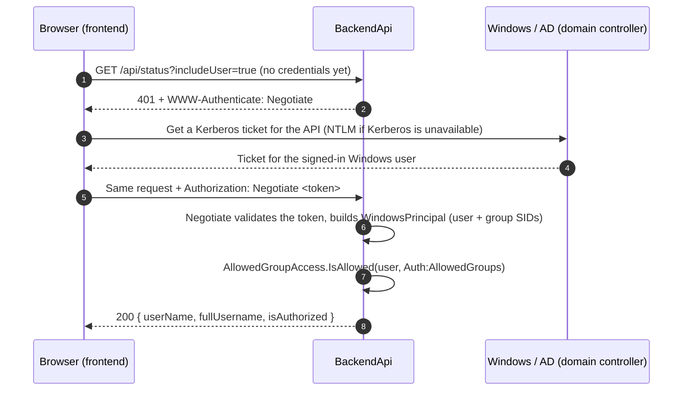
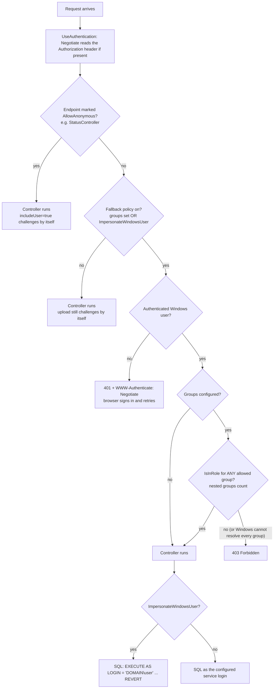
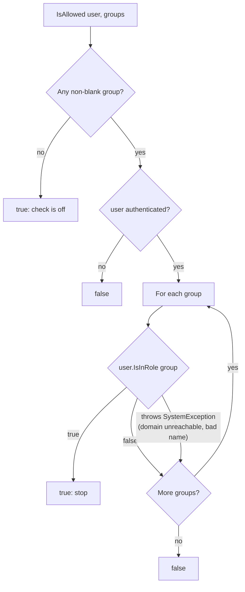
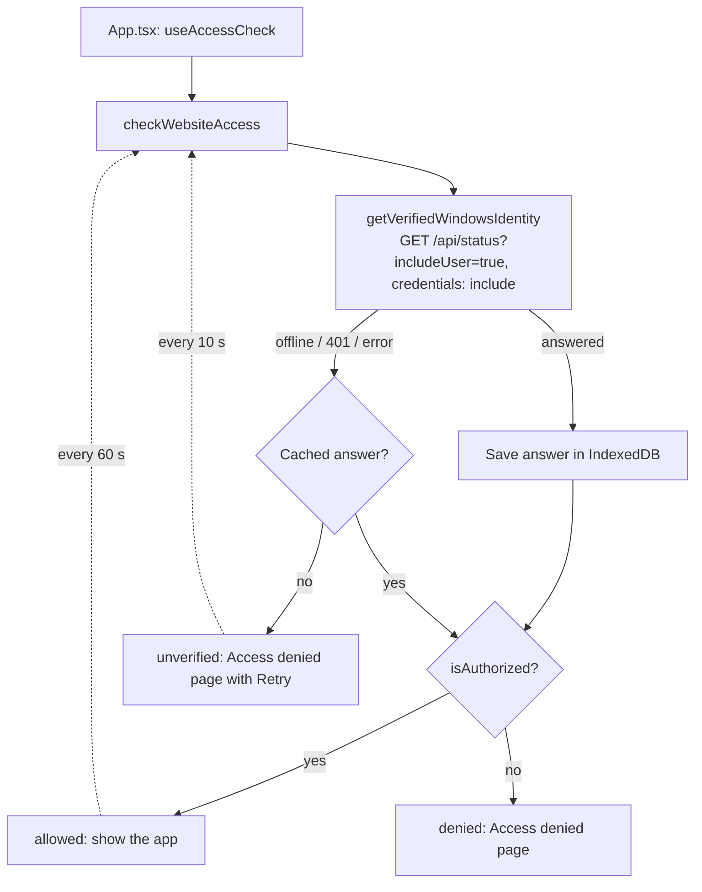
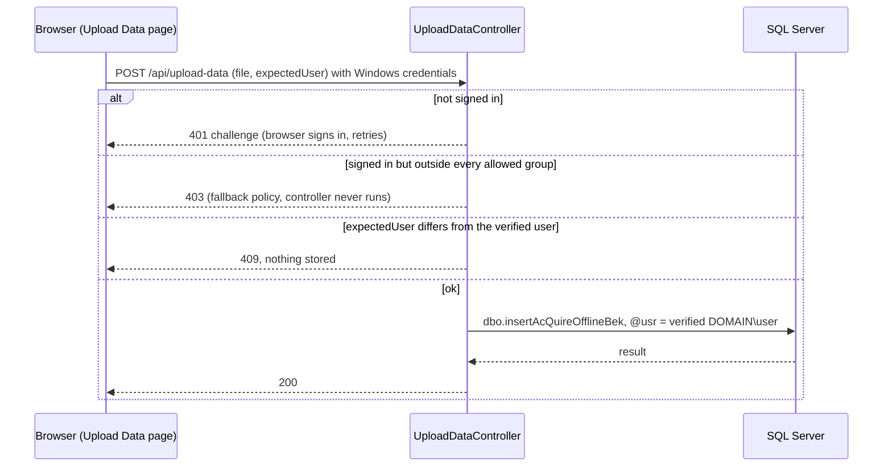

# Authentication and access

How the website knows who the user is and decides whether they may use it.

## In short

- **Who you are** comes from Windows. The API uses Windows Integrated
  Authentication (Negotiate: Kerberos, or NTLM as a fallback). The browser
  proves the signed-in Windows user; the app never sees a password, and issues
  no tokens or cookies of its own.
- **Whether you may use the website** comes from Active Directory groups in
  `Auth:AllowedGroups`. A member of **any one** of the groups is let in.
  An empty list turns the check off.
- **The backend enforces it.** The frontend only chooses what to show (the app
  or the Access denied page). Every API call from someone outside the groups
  gets `403`.

## Structure

| Piece | File | Role |
| --- | --- | --- |
| Negotiate setup | `Program.cs` | `AddAuthentication(Negotiate).AddNegotiate()`; middleware `UseAuthentication()` then `UseAuthorization()` |
| Fallback policy | `Program.cs` | Applies to every endpoint not marked `[AllowAnonymous]`: requires a Windows user, and group membership when groups are configured |
| Group check | `Auth/AllowedGroupAccess.cs` | `IsAllowed(user, groups)`: true when no groups, false when anonymous, else true if `IsInRole` for any group |
| Settings | `Data/ConfigurationExtensions.cs` | `GetAllowedGroups()` reads `Auth:AllowedGroups` plus the older `Auth:AllowedGroup`, trimmed, without blanks or duplicates |
| Status / who am I | `Controllers/Status/StatusController.cs` | `[AllowAnonymous]`. `GET /api/status` is the anonymous online check; `?includeUser=true` challenges and returns `userName`, `fullUsername`, `isAuthorized` |
| Upload | `Controllers/UploadData/UploadDataController.cs` | Always needs a Windows user (challenges itself); stores the verified `DOMAIN\user`, refuses with `409` if the page showed someone else |
| Run SQL as the user | `Data/DatabaseConnectionFactory.cs`, `Sql/WindowsUserImpersonation.sql` | With `Database:ImpersonateWindowsUser` on, every connection runs `EXECUTE AS LOGIN = 'DOMAIN\user'` and reverts afterwards |
| Frontend identity | `frontend/src/services/currentUser.ts` | Calls `/api/status?includeUser=true` with `credentials: "include"`; caches the verified identity |
| Frontend gate | `frontend/src/services/websiteAccess.ts`, `hooks/useAccessCheck.ts`, `App.tsx` | Decides `allowed` / `denied` / `unverified`; anything but `allowed` shows `pages/AccessDenied` |
| Tests | `BackendApi.Tests/ApiFactory.cs`, `Auth/AllowedGroupAccessTests.cs` | `TestAuthHandler` replaces Negotiate; user and groups come from the `X-Test-User` / `X-Test-Groups` headers |

## Settings

| Key | Example | Meaning |
| --- | --- | --- |
| `Auth:AllowedGroups` | `["BDOM\\AcQuire_Uploaders", "BDOM\\Bek-Test-Group"]` | Allowed AD groups. Any one is enough. Empty = check off |
| `Auth:AllowedGroup` | `"BDOM\\AcQuire_Uploaders"` | Older single-group key. Still read and added to the list |
| `Database:ImpersonateWindowsUser` | `false` | Run every database call as the browser user |

Each group is written as `DOMAIN\Group`; without the domain Windows cannot
match it. In JSON the backslash is doubled.

`appsettings.json` lists `BDOM\Bek-Test-Group`. `appsettings.Development.json`
sets `"AllowedGroups": [ "" ]` to switch the check off for `dotnet run` and the
tests. An empty `[]` would not do it: .NET merges arrays from settings files by
position, so an empty array leaves the base file's groups in place. The blank
entry replaces position 0 and blanks are ignored. If `appsettings.json` ever
lists more groups, add one `""` per group in the Development file.

```json
"Auth": {
  "AllowedGroups": [ "BDOM\\AcQuire_Uploaders", "BDOM\\Bek-Test-Group" ]
}
```

On IIS, set one environment variable per group (they override the JSON file
and survive a publish):

```text
Auth__AllowedGroups__0 = BDOM\AcQuire_Uploaders
Auth__AllowedGroups__1 = BDOM\Bek-Test-Group
```

At startup the API logs the groups it uses, for example
`Website access limited to members of any of these AD groups: BDOM\AcQuire_Uploaders, BDOM\Bek-Test-Group`.
An empty list logs a warning in Development and an error elsewhere.

## Decision rules

The fallback policy is switched on when groups are configured **or**
`Database:ImpersonateWindowsUser` is on. Otherwise routes are anonymous
(except upload and `includeUser=true`, which always challenge).

| Request | Policy off | Policy on, no groups (impersonation only) | Policy on, groups set |
| --- | --- | --- | --- |
| `GET /api/status` | `200` | `200` | `200` |
| `GET /api/status?includeUser=true`, anonymous | `401` challenge | `401` challenge | `401` challenge |
| `GET /api/status?includeUser=true`, signed in | `200`, `isAuthorized: true` | `200`, `isAuthorized: true` | `200`, `isAuthorized` = in any group |
| Any other route, anonymous | `200` (upload: `401`) | `401` challenge | `401` challenge |
| Any other route, signed in, in a group | `200` | `200` | `200` |
| Any other route, signed in, in no group | `200` | `200` | `403` |

`includeUser=true` answers `200` even for someone outside the groups, so the
website can say who was refused.

## Flow charts

### 1. Windows sign-in handshake

The browser sends Windows credentials on its own only to `localhost` and Local
intranet sites. Other host names must be added to the Local intranet zone (or
an `AuthServerAllowlist` policy).



### 2. One API request through the backend



### 3. Group check (`AllowedGroupAccess.IsAllowed`)



### 4. Frontend access gate

The app also works offline, so the last answer from the backend is kept in
IndexedDB and used while the backend cannot be reached.



### 5. Upload and the recorded user



## Operations

**Add or remove a group.** Edit `Auth:AllowedGroups` (or the IIS environment
variables), then recycle the app pool. The startup log shows the list in use.

**Add a user to a group.** Membership is read from the Windows login token, so
the user must sign out of Windows and back in (locking and unlocking the PC is
not enough). Until then the old membership applies.

**Troubleshooting**

| Symptom | Likely cause |
| --- | --- |
| Group member gets Access denied / `403` | Has not signed out of Windows since being added; group written without `DOMAIN\`; typo in the group name |
| Everyone gets in | `Auth:AllowedGroups` is empty in the settings the server actually uses (check the startup log) |
| Browser shows a login prompt, or `401` never turns into `200` | Site is not in the Local intranet zone; IIS Windows Authentication is off |
| A configured group never matches | Windows cannot resolve it (domain unreachable, wrong domain); other groups still work |
| `401` on IIS for everyone | Windows Authentication disabled on the site. Keep both Windows and Anonymous Authentication on in IIS |

## Testing

Unit and integration tests are in `BackendApi.Tests/Auth/AllowedGroupAccessTests.cs`.
TestServer cannot run Negotiate, so `ApiFactory` swaps in `TestAuthHandler`:
a request with `X-Test-User: BDOM\jsmith` and
`X-Test-Groups: BDOM\AcQuire_Uploaders` is signed in as that user with those
groups. Run them with:

```bash
dotnet test backend/BackendApi.Tests
```

Locally, `.claude/launch.json` has two backend profiles: `backend-group-member`
(`Auth:AllowedGroups:0=BUILTIN\Users`, you are let in) and
`backend-not-member` (`BUILTIN\Backup Operators`, you see Access denied).
